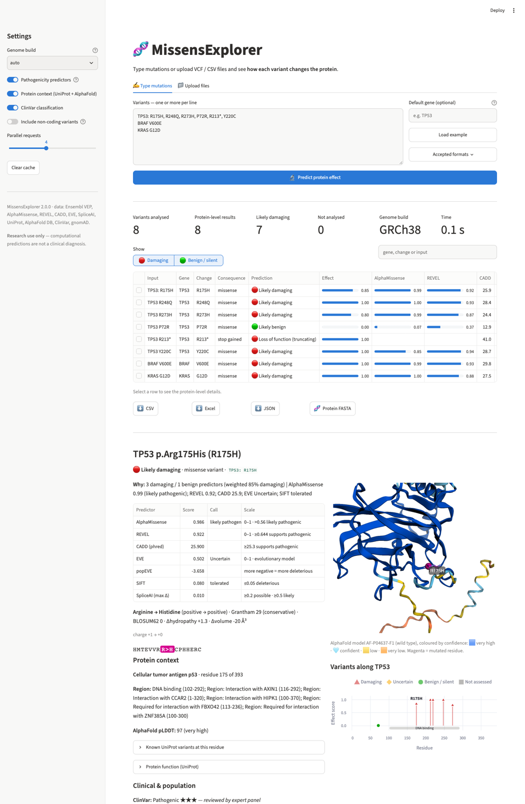

# MissensExplorer

**Predict how DNA variants change the human protein — from a VCF file, a spreadsheet, or a line like `BRAF V600E`.**

MissensExplorer maps each variant to its transcript and protein (Ensembl VEP). It then gathers
pathogenicity predictors (AlphaMissense, REVEL, CADD, EVE/popEVE, SpliceAI, SIFT, PolyPhen-2), the
physico-chemistry of the amino-acid change, and the protein context (UniProt domains and functional
sites, AlphaFold structure and confidence). Finally it adds clinical and population data (ClinVar for
the exact allele, gnomAD) and summarises everything as one prediction per variant. You can use it
from a web app, from the command line, or from Python.



> **Research use only.** The predictions are computational. They are not a clinical diagnosis.

## Quick start

```bash
git clone https://github.com/juvenalyosa/missensexplorer
cd missensexplorer
python -m venv .venv && source .venv/bin/activate      # Windows: .venv\Scripts\activate
pip install -e ".[gui,web]"

missensexplorer gui                                    # desktop app (Qt)
missensexplorer web                                    # web app at http://localhost:8501
```

### Desktop app

`missensexplorer gui` (or `missensexplorer-gui`) opens a native Qt window. Qt runs on macOS,
Windows and Linux; the app has been tested on macOS. Type variants or drag files onto the window,
then press **Predict protein effect**
(⌘/Ctrl + Enter). The results table can be filtered by prediction and searched; the panel below
shows, for the selected variant:

- the predictor scores against their published thresholds, the physico-chemistry of the change and
  the sequence around it;
- the UniProt context and the ClinVar and gnomAD data;
- three tabs: the AlphaFold model in 3D with the mutated residue highlighted, all variants along the
  protein over its domains, and the wild-type and mutant protein sequences (copy as FASTA).

The interface is available in Spanish and English (*View → Language*). Results export to Excel, CSV,
JSON and FASTA. The desktop app needs `PySide6` (installed by the `gui` extra).

To build a standalone macOS app that opens with a double click (no terminal or Python needed):

```bash
packaging/macos/build_app.sh             # -> build/macos/dist/MissensExplorer.app (about 640 MB)
packaging/macos/build_app.sh --install   # also copies it to ~/Applications
```

The build is signed ad hoc, which is enough on the Mac that built it. To share the app with other
Macs, sign it with an Apple Developer ID and notarize it; otherwise Gatekeeper blocks it on first open.

### Web app


Or with Docker:

```bash
docker build -t missensexplorer .
docker run -p 8501:8501 missensexplorer               # then open http://localhost:8501
```

### Inicio rápido (español)

1. Instala con los comandos de arriba y ejecuta `missensexplorer gui` (aplicación de escritorio, en
   español) o `missensexplorer web` (en el navegador).
2. Escribe tus mutaciones, por ejemplo `BRAF V600E` o `TP53: R175H, R248Q`, o arrastra tu VCF a la
   ventana.
3. Pulsa **Predecir efecto en la proteína** (⌘/Ctrl + Enter). Haz clic en una fila para ver el
   detalle: predictores, cambio fisicoquímico, dominio afectado, estructura 3D de AlphaFold, ClinVar
   y gnomAD.
4. Exporta los resultados a Excel, CSV, JSON o FASTA (proteína mutante).

## What you can give it

Free text accepts one or more variants per line, separated by commas or semicolons:

| You write | Meaning |
|---|---|
| `BRAF V600E` · `BRAF:p.Val600Glu` · `KRAS p.G12D` | protein change in a gene |
| `TP53: R175H, R248Q, R273H` | several changes in the same gene |
| `V600E` together with `--gene BRAF` (or *Default gene* in the web app) | bare change |
| `BRCA1:c.5096G>A` · `NM_004333.6(BRAF):c.1799T>A` · `ENST00000269305:c.524G>A` | cDNA HGVS |
| `chr7:140753336 A>T` · `7-140753336-A-T` · `7 140753336 A T` | genomic position and alleles |
| `NC_000007.14:g.140753336A>T` | genomic HGVS |
| `rs113488022` | dbSNP ID (all alternate alleles are reported) |
| `CFTR p.Phe508del` · `chr7:117559590 ATCT>A` | in-frame indels |

You can also upload files:

- **VCF / VCF.gz**: single- or multi-sample, multi-allelic, SNVs and indels. Zygosity is taken
  from `GT`. Sites that the sample does not carry (`0/0`, `./.`) are skipped.
- **CSV / TSV / Excel**: either `chrom,pos,ref,alt` columns, or a column of variants (`variant`,
  `hgvs`, `mutation`, `rsid`, …) with an optional `gene` column.
- **TXT**: one variant per line, in any of the formats above.

The **genome build is detected automatically**, first from the VCF header (contig lengths or
reference name). If the header has no build, the tool checks the REF alleles against GRCh38 and
GRCh37. You can force a build with `--assembly GRCh37`.

## Command line

```bash
# a few mutations, printed as a table with detail cards
missensexplorer "BRAF V600E" "TP53: R175H, R248Q" rs28934578

# bare changes in one gene, plus the mutant protein sequences
missensexplorer --gene TP53 R175H R248Q R273H --fasta tp53_mutants.fa

# a VCF, restricted to some genes, with Excel and CSV reports
missensexplorer -f patient.vcf.gz --genes TP53,BRCA1,BRCA2 -o report.xlsx -o report.csv

# options
missensexplorer --help
```

Useful flags:

| Flag | Effect |
|---|---|
| `--sample NAME` | report one sample of a multi-sample VCF |
| `--pass-only` | keep only `FILTER=PASS` records |
| `--all` | also list non-coding consequences (intronic, UTR, intergenic) |
| `--no-predictors` | skip the predictor plugins (faster) |
| `--workers N` | number of parallel API requests (default 4) |
| `--vep local` | annotate with VEP on this computer instead of the public API ([guide](docs/local-vep.md)) |
| `--offline` | never use the internet (with `--vep local`; skips ClinVar, UniProt and AlphaFold) |
| `--common-af AF` | gnomAD grpmax at which damaging/uncertain calls become benign (default `0.05` = BA1; `0` = off) |
| `--no-cache` | ignore the local cache |
| `missensexplorer cache clear` | empty the local cache |

## Python

```python
from missensexplorer import predict, PredictOptions

res = predict(text="BRAF V600E\nTP53 R175H", files=["sample.vcf.gz"],
              options=PredictOptions(genes=["TP53", "BRAF"]))
res.table          # pandas DataFrame, one row per variant × gene
res.errors         # inputs that could not be parsed or mapped
res.sequences      # wild-type and mutant protein sequences per row
```

## What you get for each variant

| Group | Columns |
|---|---|
| Protein change | `gene`, `protein_change` (V600E), `hgvsp`, `hgvsc`, `consequence`, `transcript` (MANE Select preferred), `exon`, `codons` |
| **Prediction** | `prediction`, `effect_score` (0–1; the model score for missense variants), `prediction_basis` (model score, contributions, predictors) |
| ACMG evidence | `acmg_pp3_bp4` (e.g. `PP3_Strong (model 0.994)`), `acmg_points`, `population_frequency` (BA1 / BS1 candidate / rare / not in gnomAD) |
| Predictors | `alphamissense`, `revel`, `cadd_phred`, `eve`, `popeve`, `sift`, `polyphen`, `spliceai_max` |
| Physico-chemistry | `grantham`, `blosum62`, `hydropathy_change`, `volume_change`, `charge_change`, `physchem_notes` |
| Protein context | `protein_name`, `protein_window` (e.g. `GDFGLAT[V>E]KSRWSGS`), `key_site`, `protein_features`, `uniprot_variants_here`, `uniprot_mutagenesis_here`, `plddt`, `protein_function` |
| Clinical & population | `clinvar` (classification of the exact allele), `clinvar_review` and stars, `clinvar_conditions`, `clinvar_oncogenicity`, `gnomad_af`, `gnomad_popmax_af` (grpmax: highest main genetic ancestry group), `rsid`, `pubmed_ids` |
| Truncating variants | `nmd` (rule-of-thumb nonsense-mediated decay), `mutant_protein` (% of the protein lost) |
| Sample | `zygosity`, `genotype`, `sample` or `carriers` |

### How the prediction is made

- **Truncating variants** (stop-gained, frameshift, canonical splice site, start-lost) are reported
  as *Loss of function*, with an NMD estimate and the percentage of the protein that is lost.
- For a **missense** variant, a logistic regression combines the scores of AlphaMissense, REVEL,
  CADD and popEVE into a *model score* (0–1). At 0.76 or more the variant is
  *Likely damaging*; at 0.30 or less, *Likely benign*; in between, *Uncertain*. The model was
  trained on expert-reviewed ClinVar variants from genes that the benchmark does not use, with
  extra weight on the hard cases (rare benign variants), and every call shows how much each
  predictor pushed it (desktop app: *Why* chart). The coefficients, the training data, the choice
  of cut-offs and the validation are described in the [model card](docs/model.md).

  The model needs AlphaMissense or REVEL. Without both (for example local VEP without plugins), a
  weighted vote of CADD and EVE decides, and SIFT/PolyPhen-2 vote only when nothing better exists;
  the label then says *limited evidence*.
- **Population frequency** is a separate, visible rule: a damaging or uncertain call becomes
  *Likely benign (common in population)* when the variant reaches 5% in a gnomAD genetic ancestry
  group (ACMG BA1; bottlenecked groups excluded, as in gnomAD's *grpmax*). The protein-level call
  stays in `prediction_basis`. Change the cut-off with `--common-af` (`0.01`, or `0` to turn it
  off) or *Options → Frequency* in the desktop app. A 1% cut-off removes more benign variants but
  also mislabels pathogenic variants of recessive and founder conditions. The nine variants on
  ClinGen's BA1 exception list (Ghosh et al., 2018; for example HFE C282Y and H63D, GJB2 V37I,
  BTD D444H) are never called benign for being common.
- **ACMG computational evidence**: `acmg_pp3_bp4` and `acmg_points` give PP3/BP4 from the model
  score, for example `PP3_Strong (model 0.994)` = +4 points.
  - The thresholds were calibrated with ClinGen's method
    ([Pejaver et al. 2022](https://pmc.ncbi.nlm.nih.gov/articles/PMC9748256/)) on the same ClinVar
    data that set REVEL's ClinGen thresholds, and checked on two independent sets
    ([details](docs/model.md#acmg-pp3bp4-from-the-model-score)).
  - At the same strength of evidence, the model gives PP3 Strong to 46% of the pathogenic variants of
    ClinVar's 2020 test set (REVEL: 28%) and BP4 to 76% of the benign ones (REVEL: 66%).
  - The calibration is this project's, not one published by ClinGen. `--acmg-source revel` (desktop
    app: *Options → PP3/BP4*) uses REVEL with ClinGen's published thresholds instead, or AlphaMissense
    when REVEL is missing ([Bergquist et al. 2025](https://www.ccs.neu.edu/home/radivojac/papers/bergquist_genetmed_2025.pdf)).
  - `population_frequency` says whether the variant meets BA1, is a BS1 candidate (≥ 1%), is rare or
    was not found in gnomAD.
  - These columns are one input of an ACMG classification, not a classification.
- **Synonymous, splice-region and intronic** variants are judged with SpliceAI
  (≥ 0.5 likely splice-altering, ≥ 0.2 possible).
- ClinVar is shown next to the prediction, never mixed into it.

## Speed

All lookups are batched: up to 200 variants per Ensembl VEP request, run in parallel. For more
than 200 variants, a fast first pass finds the coding and splice variants, and only those go
through the slower predictor plugins. Every answer is cached in `~/.cache/missensexplorer`, so a
repeated run is almost instant. As a reference, 1,000 VCF variants take about 40 s the first time
and about 1 s from the cache.

For exomes and genomes, pass `--genes` (or fill *Only these genes* in the web app). The VCF is then
filtered locally before anything is sent. The public Ensembl REST API is not meant for millions of
variants; for whole genomes, use the [local VEP mode](docs/local-vep.md). VCF files are read as a
stream, so large files do not have to fit in memory.

## Privacy

The tool sends only variant descriptions (coordinates, HGVS, rsIDs, gene symbols) to the public
APIs of Ensembl, UniProt, AlphaFold DB and NCBI. Sample names and genotypes stay on your
computer. Even so, check your institution's rules before you analyse patient data with public web
services. With `--vep local --offline` (or *Local VEP* + *Offline* in the desktop app) nothing
leaves the computer.

## Reliability

- **Failures are visible.** Each external source (VEP, its predictor plugins, ClinVar, UniProt,
  AlphaFold, protein sequences) is tracked. If one does not respond, the result says so in a
  warning, the affected rows say so in `notes`, and running the analysis again retries only what is
  missing, because everything already obtained is cached. A failed predictor request no longer
  discards the rest of the annotation.
- **Fast, clear errors offline.** A host that refuses connections is marked as down after a few
  attempts, instead of retrying for minutes.
- **Every run is recorded.** Exports include the tool version, the Ensembl release, the options,
  the SHA-256 of each input file and the status of each source (JSON `run`, Excel *Run info* sheet,
  *Help → Run information* in the desktop app). Cached VEP answers are tied to the Ensembl release.
  ClinVar answers are refreshed every week.
- **Tested on hard cases.** Recorded VEP responses cover frameshifts, start-lost, canonical splice,
  splice-altering synonymous, mitochondrial, chromosome X, multi-allelic and GRCh37 variants. A
  nightly GitHub workflow checks that the external APIs still return the fields the tool reads.
- **Measured against ClinVar, on genes the model never saw.** On 1,972 expert-reviewed (≥ 2 stars)
  germline missense variants from 1,181 genes, version 2.3 calls 91% of the pathogenic variants
  *damaging* (v2.1: 89%) and 88% of the benign ones *benign* (v2.1: 87%). 92.7% of the variants get
  a decisive call, and decisive calls are right 97% of the time (2.4% of pathogenic variants are
  called benign; 3.2% of benign variants are called damaging, against 5.2% with v2.1). On **rare**
  variants (gnomAD < 0.1%), where most of a patient's variants are, 6.0% of the benign ones are
  called damaging (v2.1: 9.0%) and 91.6% of the pathogenic ones are found (v2.1: 89.2%). The AUC of
  the model score is 0.985 (v2.1: 0.959); on rare variants it is 0.974 (v2.1: 0.937). Some predictors
  were trained or calibrated on similar data, so treat absolute figures as optimistic. The
  [benchmark](benchmarks/results/clinvar_benchmark.md) has per-predictor, rare-variant and
  since-2024 results, and the [model card](docs/model.md) explains training, validation and limits.
  `benchmarks/clinvar_benchmark.py` and `benchmarks/train_model.py` reproduce them.
- **Compared with 31 other predictors** on the same held-out variants
  ([comparison](docs/comparison.md)). Among the predictors that leave out allele frequency, as ClinGen
  recommends for ACMG PP3/BP4, MissensExplorer ranks best (AUC 0.985; REVEL 0.982; AlphaMissense
  0.964). MetaRNN ranks higher (0.996), but the gap is allele frequency, which MetaRNN takes as input.
  Adding frequency to the MissensExplorer score gives the same AUC. The comparison also lists similar
  software (ProtVar, VarSome, Franklin, InterVar, OpenCRAVAT…) and what each one uses.
- **Checked on laboratory data, without ClinVar.** On 13,408 variants whose effect was measured by deep
  mutational scanning (61 human proteins, [ProteinGym](https://proteingym.org)), MissensExplorer's
  score correlates best with the measured loss of function: Spearman 0.469, against popEVE 0.460,
  AlphaMissense 0.458, MetaRNN 0.438, REVEL 0.425 and CADD 0.344
  ([results](benchmarks/results/proteingym_validation.md)).
- **ACMG evidence calibrated like REVEL's.** The thresholds behind PP3/BP4 were set with ClinGen's
  method on ClinGen's own calibration data. A port of the authors' code reproduces REVEL's published
  thresholds to within 0.002. On ClinVar's 2020 test set every evidence band reaches the likelihood
  ratio its strength needs, and the model gives stronger evidence more often than REVEL
  ([calibration](benchmarks/results/acmg_calibration.md)).
- The desktop app writes an error log (*Help → Open error log*; on macOS
  `~/Library/Logs/MissensExplorer`).

## What changed in version 2

Version 2 is a rewrite. The pipeline used to make roughly ten sequential web requests per SNP
through UCSC, Ensembl, UniProt and NCBI. It now uses one batched Ensembl VEP call and adds
modern predictors, protein structure and a web interface. The rewrite also fixes these bugs in the
1.x scripts (kept in [`legacy/`](legacy/)):

- SNVs at the third base of a codon were compared with the *next* codon, so they were reported as
  synonymous.
- Only the first protein-coding transcript of a gene was checked. If the SNP was not in its exons,
  the variant was reported as non-coding.
- Nonsense variants were never detected, because the check compared a sequence's length with
  itself.
- A missense variant without an existing UniProt variant record was silently dropped, so new
  variants never appeared in the output.
- ClinVar data was never returned, because of a key check bug.
- `0/0` genotypes were reported as homozygous variants.
- Indels were ignored.

*Agent Smith*, the PubMed + OpenAI summariser, is still available unchanged in `legacy/agentsmith.py`.

## Development

```bash
pip install -e ".[dev,gui]"
pytest                 # fast offline tests (the desktop tests run headless)
pytest -m network      # live end-to-end tests against the public APIs

pip install -e ".[benchmark]"
python benchmarks/train_model.py        # retrain the missense model (benchmark genes held out)
python benchmarks/clinvar_benchmark.py  # held-out ClinVar benchmark
python benchmarks/compare_tools.py      # same benchmark, 31 other predictors (dbNSFP)
python benchmarks/validate_proteingym.py  # independent check on deep mutational scanning data
python benchmarks/feature_tests.py      # inputs tested for the model and rejected
python benchmarks/calibrate_acmg.py     # ACMG PP3/BP4 thresholds of the model score (ClinGen method)
```

## Data sources

Ensembl VEP REST (McLaren et al., 2016) · AlphaMissense (Cheng et al., 2023) · REVEL (Ioannidis et
al., 2016) · CADD (Rentzsch et al., 2019) · EVE (Frazer et al., 2021) and popEVE · SpliceAI
(Jaganathan et al., 2019) · SIFT · PolyPhen-2 · UniProt · AlphaFold DB (Varadi et al., 2024) ·
ClinVar · gnomAD · Grantham (1974) · BLOSUM62 · Kyte–Doolittle hydropathy · ClinGen PP3/BP4
calibration (Pejaver et al., 2022; Bergquist et al., 2025).

# Powered by

### Universidad Simón Bolívar Barranquilla
### Escuela Nacional del Deporte

- Briyis Fontecha briyis.fontecha@unisimon.edu.co
- Jorge Leyva jorge.leyva@unisimon.edu.co
- Yecid Mina yecid.mina@endeporte.edu.co
- Juvenal Yosa juvenal.yosa@unisimon.edu.co
