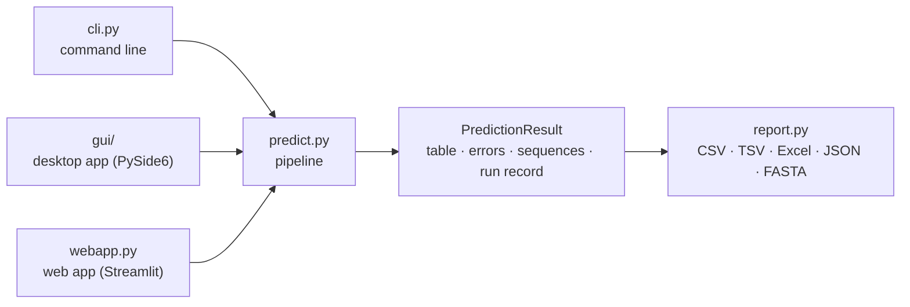

# Architecture

MissensExplorer has three front ends on top of one analysis engine. The engine turns any variant
input into a results table: one row per variant and gene. Each row holds the annotation, the
prediction and its ACMG evidence.

All three front ends call `predict()` and show its `PredictionResult`, so they always give the
same answer.

## Modules

| Module | Role |
|---|---|
| `predict.py` | The pipeline. It defines `predict()`, `PredictOptions`, `PredictionResult`, the output `COLUMNS` and the classification rules (`classify`, `apply_frequency`) |
| `inputs.py` | Parses VCF/VCF.gz, CSV/TSV/Excel and free text (protein changes such as `BRAF V600E`, cDNA and genomic HGVS, rsIDs, genomic positions) into `VariantInput` records |
| `api.py` | The HTTP client shared by all services: retries, back-off on HTTP 429, a per-host circuit breaker, offline mode and `SourceStatus` (what worked and what failed) |
| `cache.py` | SQLite key/value cache of API responses (`~/.cache/missensexplorer`, thread-safe) |
| `vep.py` | Ensembl VEP REST client: consequences, HGVS, MANE transcript, gnomAD frequencies and predictor scores (dbNSFP, SpliceAI) |
| `vep_local.py` | The same annotation from a VEP installed on this computer (offline mode) |
| `clinvar.py` | NCBI E-utilities: the exact ClinVar record of each variant, and every pathogenic variant near a position |
| `gnomad.py` | gnomAD GraphQL API: a direct check for variants that VEP gave no frequency, and exome coverage, for PM2. Rate-limited to 10 requests per minute |
| `protein.py` | UniProt features and AlphaFold pLDDT around the changed residue; wild-type and mutant protein sequences |
| `aa.py` | Amino-acid tables and substitution properties (Grantham, BLOSUM62, hydropathy, volume, charge) |
| `model.py` | The missense model score (logistic regression over AlphaMissense, REVEL, CADD and popEVE) and the score with frequency |
| `acmg.py` | ACMG/AMP evidence: PP3/BP4 at calibrated thresholds, PM2, BA1/BS1 and the code summary |
| `residue.py` | PS1/PM5 from ClinVar's pathogenic variants at the same residue |
| `oncogenicity.py` | Optional somatic oncogenicity points (ClinGen/CGC/VICC): cancerhotspots.org hotspots, IntOGen gene roles, CIViC functional evidence, ClinVar oncogenicity classifications at the residue, gnomAD and the model; and CIViC's clinical evidence |
| `report.py` | Exports (CSV, TSV, Excel with a run-info sheet, JSON, FASTA) and the terminal view |
| `_types.py` | Shared type aliases (`Row`, `JSON`, `Progress`) and the cache protocol |
| `model_params.py`, `calibration_params.py`, `frequency_params.py` | Generated coefficients and thresholds. Never edited by hand: see [Reproducibility](#reproducibility) |
| `gui/` | Desktop app: main window (`window.py`), table model (`models.py`), custom-painted widgets (`widgets.py`), themes, settings, English/Spanish strings (`i18n.py`) |

## The pipeline

`predict()` runs these stages in order. Each one reports progress through the `progress` callback,
which the desktop app shows as a progress bar.

| # | Stage | Module | Service | Cached for |
|---|---|---|---|---|
| 1 | Read and parse the input | `inputs.py` | — | — |
| 2 | Detect the genome build: from the VCF header, or else by checking the REF bases against GRCh38 and GRCh37 | `predict.py` | Ensembl | 30 days |
| 3 | Annotate: consequence, transcript, HGVS, gnomAD frequency. A protein substitution that several SNVs produce is asked again with `ambiguous_hgvs`; HGVS insertions and deletions are re-annotated in their left-aligned VCF form | `vep.py` / `vep_local.py`, `predict.py` | Ensembl VEP | 30 days |
| 4 | Predictor scores for protein-altering and splice variants only (a slower second pass on large inputs) | `vep.py` | Ensembl VEP plugins | 30 days |
| 5 | ClinVar record of the exact allele | `clinvar.py` | NCBI | 7 days |
| 6 | ClinVar pathogenic variants at the same residue (PS1/PM5) | `clinvar.py`, `residue.py` | NCBI | 7 days |
| 6b | Only with `oncogenicity=True`: hotspots, IntOGen gene roles, CIViC evidence, and ClinVar variants with an oncogenicity classification at the same residue | `oncogenicity.py`, `clinvar.py` | cancerhotspots.org, IntOGen, CIViC, NCBI | 90 days (CIViC and ClinVar 7) |
| 7 | Direct gnomAD check for variants VEP gave no frequency (PM2) | `gnomad.py` | gnomAD | 90 days |
| 8 | Protein context: UniProt features, AlphaFold pLDDT | `protein.py` | UniProt, AlphaFold | 30 days |
| 9 | Build the rows: model score, prediction, ACMG evidence, oncogenicity points, protein sequences | `model.py`, `acmg.py`, `residue.py`, `oncogenicity.py`, `aa.py` | — | — |

**Transcript.** VEP picks one consequence per allele and gene, preferring MANE Select, then the
canonical transcript (`pick_allele_gene`).

**What decides the prediction.**
- Truncating variants are *Loss of function*.
- Missense variants are decided by the model score. Without AlphaMissense and REVEL, a weighted
  vote decides and the label says *limited evidence*.
- Splice-region, synonymous and intronic variants are judged by SpliceAI.
- In-frame changes are judged by CADD.
- Population frequency (BA1) is applied afterwards, as a separate, visible rule.
- ClinVar is shown next to the prediction and never feeds into it.

## Network and failure handling

Every web request goes through `api.Http`:

- **Retries.** HTTP 429 and 5xx errors are retried with back-off, honouring `Retry-After`. Each
  request waits at most 90 s in total.
- **Circuit breaker.** After three consecutive requests to a host fail despite their retries, the
  host is marked as down. The rest of the run skips it instead of waiting on it.
- **`SourceStatus`.** Each failure is recorded per source. The run then finishes with those columns
  empty and a warning that names the source. One failing service never stops an analysis.
- **Offline mode** (`--offline`): uses the local VEP only and makes no web requests.

Responses are cached in SQLite, so a repeated run takes about a second.

What leaves the computer is described in the README's *Privacy* section. Only variant descriptions
are sent (coordinates, HGVS, rsIDs, gene symbols), never sample names or genotypes.

## Results

`PredictionResult` holds:

- `table`: one row per variant and gene, with the columns listed in `predict.COLUMNS`;
- `errors`: inputs that could not be read or annotated, with the reason;
- `warnings`: messages for the user, for example a service that failed;
- `sequences`: wild-type and mutant protein sequences per row;
- `run`: the run record (versions, options, inputs, sources).

The run record makes each analysis traceable. It is exported with the results and stores the model
version and training date, the Ensembl release and the status of each source.

## Reproducibility

The numbers the tool ships come from the scripts in `benchmarks/`. Each script writes its outputs
to `benchmarks/results/`:

| Script | Writes |
|---|---|
| `train_model.py` | `model_params.py` (coefficients, cut-offs), training set |
| `calibrate_acmg.py` | `calibration_params.py` (PP3/BP4 thresholds) |
| `train_frequency_score.py` | `frequency_params.py` (score with frequency) |
| `clinvar_benchmark.py`, `compare_tools.py` | Held-out ClinVar benchmark, comparison with 31 tools |
| `validate_proteingym.py` | Validation on deep mutational scanning data |
| `validate_egfr.py` | EGFR tumour variants against a transformation assay (outside the model's scope) |
| `validate_oncogenicity.py` | The oncogenicity points on EGFR (oncogene, transformation assays) and TP53 (tumour suppressor, NCI TP53 Database functional classes) |
| `feature_tests.py`, `acmg_criteria.py` | Inputs tested and rejected; how informative PS1/PM5/PM2 are |

**Version guard.** The calibration and the score with frequency belong to one trained model. Each
generated file records the model version and training date it was made for. After a retrain, the
calibrated PP3/BP4 thresholds stay switched off until `calibrate_acmg.py` is run again. Until then,
PP3/BP4 falls back to REVEL with ClinGen's published thresholds.

## Tests

`tests/` runs offline. Web services are mocked or replayed from fixtures in `tests/data/`, and the
desktop app is tested headless.

Tests marked `network` call the live APIs. They run every night in CI (`.github/workflows/nightly.yml`),
so a change in an external service shows up before users hit it.

See [CONTRIBUTING.md](../CONTRIBUTING.md) for the checks every change must pass.

## Packaging

`packaging/build.py` freezes the desktop app with PyInstaller (`packaging/launcher.py` is the entry
point) and builds the installer for the system it runs on. PyInstaller does not cross-compile, so
the `installers` workflow runs it on macOS (Apple Silicon and Intel), Windows and Linux.

| System | Installer | Tooling |
|---|---|---|
| macOS | `.dmg` with the app and an Applications link; ad hoc signature | `hdiutil`, `codesign` |
| Windows | `Setup.exe`, per-user, with Start menu and desktop shortcuts and an uninstaller | Inno Setup (`packaging/windows/MissensExplorer.iss`) |
| Linux | `.deb` (installs in `/opt`, declares the X11 and NSS libraries Qt needs) and a `.tar.gz` with `install.sh` | `dpkg-deb` |

Each build ends with the packaged app's self-test: it predicts BRAF V600E online and draws the 3D
structure (`--smoke`). Qt is pinned in `packaging/requirements-installer.txt`.

